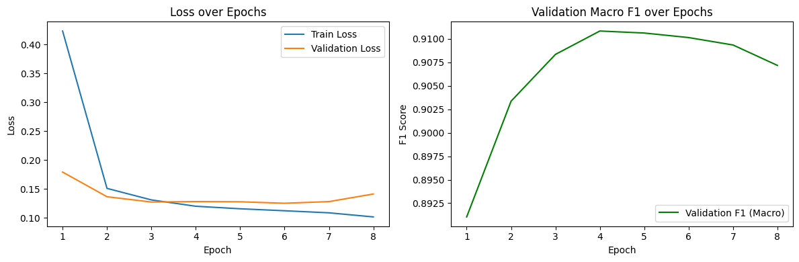
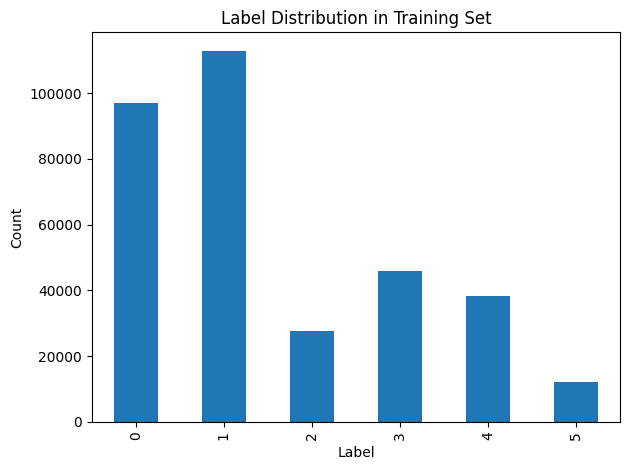

# Twitter Emotion Classification

A PyTorch model that reads a tweet and predicts which of six emotions it expresses. The model is a bidirectional GRU trained on roughly 330,000 labelled tweets, and it reaches a **macro F1 of 0.911** on a held-out validation set.

The notebook was built for a Kaggle-style text classification competition and runs end to end in Google Colab.

---

## Results

| Metric | Value |
|---|---|
| Best validation macro F1 | **0.911** (epoch 4) |
| Epochs trained | 8 (early stopping) |
| Classes | 6 emotions |



Validation F1 peaks at epoch 4. After that, training loss keeps falling while validation loss rises, which is the start of overfitting, so early stopping halts training and the epoch-4 weights are kept.

---

## The data

The training set is imbalanced: the two largest classes have around 100,000 tweets each, while the smallest has about 12,000.



Because of this, the model is evaluated with **macro F1** (the average F1 across classes, each weighted equally) rather than accuracy, and the loss function uses class weights so that the rare emotions are not ignored.

---

## How it works

**1. Text cleaning.** Tweets are lowercased, and links, numbers, punctuation and extra spaces are removed. Tweets shorter than 4 words or longer than 60 are dropped as outliers.

**2. Tokenisation.** A vocabulary of the 10,000 most frequent words is built from the training set. Each tweet becomes a sequence of 200 word IDs, with padding for short tweets and an out-of-vocabulary token for rare words.

**3. Model.**

```
Embedding (300-d)  →  Bidirectional GRU (256 units each way)  →  Dropout (0.5)  →  Linear (6 classes)
```

Reading each tweet in both directions lets the model use context from before and after every word. The final hidden states of both directions are concatenated before classification.

**4. Training.**
- 80/20 stratified train/validation split
- Cross-entropy loss with balanced class weights
- Adam optimiser (learning rate 4e-4)
- Learning-rate scheduler that halves the rate when validation F1 stops improving for 2 epochs
- Early stopping after 4 epochs without improvement, saving the best model

**5. Output.** The best model predicts the test set and writes `submission_pytorch.csv`. The trained weights, vocabulary and label encoder are exported so the model can be reused without retraining.

---

## Running it

1. Open `emotion_classification.ipynb` in Google Colab (a GPU runtime is recommended).
2. Upload `train_kaggle.csv` and `test_kaggle.csv` to the session. Each needs a `text` column; the training file also needs a `label` column, and the test file an `ID` column.
3. Run all cells.

**Stack:** Python, PyTorch, pandas, NumPy, scikit-learn, Matplotlib

---

## Possible improvements

- Replace the learned embeddings with pre-trained ones (GloVe or fastText)
- Fine-tune a transformer such as DistilBERT, which typically adds several points of F1 on this kind of task
- Keep emojis and hashtags instead of stripping them, since they carry a lot of emotional signal in tweets
